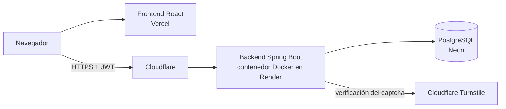
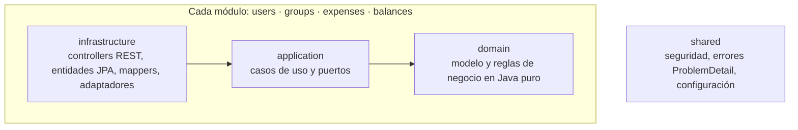

# SharedExpenses

Aplicación web para gestionar gastos compartidos en grupo (viajes, pisos compartidos, cenas): registra quién
pagó cada gasto y cómo se reparte, calcula el balance de cada miembro y propone el mínimo número de pagos para
saldar las deudas.

Trabajo de Fin de Máster — Máster de Desarrollo con IA (BIG School).

## Enlaces

| | |
|---|---|
| Aplicación | https://sharedexpenses-two.vercel.app |
| API (backend) | https://sharedexpenses-dso8.onrender.com |
| Documentación de la API (Swagger) | https://sharedexpenses-dso8.onrender.com/swagger-ui.html |
| Vídeo de demostración | [Ver en Google Drive](https://drive.google.com/file/d/1wKt8DVJYTP3AyVY06UCQxvBkdUa42J0z/view?usp=sharing) |
| Presentación | [docs/slides.pdf](docs/slides.pdf) · [Ver en Google Drive](https://drive.google.com/file/d/1wonsgUnuyutIfnO7JtQF4GBUZKOs37ti/view?usp=drive_link) |
| Usuario de prueba | Ver [Usuario de prueba](#usuario-de-prueba) |

> El backend usa el plan gratuito de Render, que se duerme tras un rato sin uso: **la primera petición puede
> tardar hasta un minuto**. La aplicación lo avisa con el mensaje «El servidor se está despertando».

## Índice

1. [Descripción general](#descripción-general)
2. [Funcionalidades principales](#funcionalidades-principales)
3. [Stack tecnológico](#stack-tecnológico)
4. [Arquitectura](#arquitectura)
5. [Reglas de negocio](#reglas-de-negocio)
6. [Seguridad](#seguridad)
7. [Estructura del proyecto](#estructura-del-proyecto)
8. [Instalación y ejecución](#instalación-y-ejecución)
9. [Documentación de la API](#documentación-de-la-api)
10. [Tests](#tests)
11. [Despliegue](#despliegue)
12. [Usuario de prueba](#usuario-de-prueba)
13. [Desarrollo asistido por IA](#desarrollo-asistido-por-ia)
14. [Posibles mejoras](#posibles-mejoras)

## Descripción general

**El problema.** Cuando un grupo comparte gastos, por ejemplo en un viaje, uno paga el hotel, otro la cena y otro
el taxi. Al final nadie recuerda bien quién pagó qué, no todo se reparte a partes iguales y, para saldar las
cuentas, cada persona acaba haciendo varias transferencias.

**La solución.** SharedExpenses lleva esas cuentas por el grupo:

1. Cada miembro apunta el gasto en el momento: quién lo pagó y entre quién se reparte.
2. El reparto puede ser a partes iguales, por importes o por porcentajes, y siempre cuadra al céntimo.
3. La aplicación calcula el balance de cada persona: cuánto debe o cuánto le deben. La suma del grupo es siempre 0.
4. La liquidación propone el **mínimo número de pagos** para que todo el mundo quede en paz (como mucho N−1 pagos
   para N personas con saldo pendiente).

Ejemplo: en un viaje de tres personas con una cena de 10 €, un hotel de 300 € y un taxi de 24 €, la aplicación
salda todas las deudas con solo dos pagos.

La aplicación no integra IA: la IA se ha usado como herramienta de desarrollo (ver
[Desarrollo asistido por IA](#desarrollo-asistido-por-ia)).

## Funcionalidades principales

- **Cuentas de usuario:** registro e inicio de sesión con JWT, cambio de contraseña y eliminación de la cuenta.
- **Grupos:** crear, editar el nombre y la descripción, ver el detalle, añadir miembros por email, eliminar
  miembros (solo el creador), abandonar el grupo y eliminar el grupo (solo el creador).
- **Gastos:** crear, editar y eliminar, con tres tipos de reparto:
  - a partes iguales,
  - por importes,
  - por porcentajes (se guardan los porcentajes originales para poder editarlos).

  Cada gasto muestra quién lo pagó, quién lo añadió y cómo se ha repartido.
- **Balances:** saldo de cada miembro, con la suma del grupo siempre a 0.
- **Liquidación:** el mínimo de pagos para saldar las deudas, con un botón para marcar cada pago como hecho.
- **Pagos:** registrar pagos entre miembros (con aviso si superan la deuda real), ver el historial y eliminarlos.
- **Interfaz:** en español, responsive (móvil y escritorio), con modo oscuro según el sistema y diálogos de
  confirmación propios.

## Stack tecnológico

| Capa | Tecnologías |
|---|---|
| Backend | Java 21, Spring Boot 3.5 (Web, Data JPA, Security, Validation), Maven |
| Seguridad | Spring Security con JWT (`oauth2-resource-server`, firma HS256), BCrypt, Cloudflare Turnstile |
| Base de datos | PostgreSQL (Neon) en producción, H2 en desarrollo y tests, migraciones con Flyway |
| Documentación de la API | springdoc-openapi (Swagger UI) |
| Frontend | React 19, Vite 8, React Router 7, `fetch` nativo, CSS propio (sin librerías de componentes) |
| Tests | JUnit 5, AssertJ, Mockito, MockMvc, `@DataJpaTest` |
| Infraestructura | Docker (imagen multi-stage), docker-compose, Render, Neon, Vercel |

## Arquitectura

### Vista general



### Monolito modular con arquitectura hexagonal ligera

El backend es un único servicio (sin microservicios, colas ni buses de eventos) organizado por **módulos de
negocio**. Cada módulo tiene tres capas:



| Capa | Contiene | Reglas |
|---|---|---|
| `domain` | `Group`, `Expense`, `SplitStrategy`, `BalanceCalculator`, `DebtSimplifier`… | Java puro: sin Spring ni JPA |
| `application` | Un caso de uso por clase (`CreateExpenseUseCase`…) y los puertos (interfaces) | Depende solo del dominio y de interfaces |
| `infrastructure` | Controllers con DTOs (records), adaptadores JPA, configuración de cada módulo | Implementa los puertos; las entidades JPA no salen del adaptador |

Un test de arquitectura (`ArchitectureTest`) lee los `import` del código y **rompe el build** si el dominio o la
aplicación importan Spring, Jakarta o código de infraestructura.

### Comunicación entre módulos

Un módulo solo usa los casos de uso públicos de otro, nunca sus repositorios. Cuando un módulo necesita algo de
otro que a su vez depende de él, **define su propio puerto** y el otro módulo lo implementa (inversión de
dependencias), de modo que no hay dependencias circulares:

| Puerto | Definido en | Implementado en | Para qué |
|---|---|---|---|
| `MemberBalanceProvider` | `groups` | `balances` | Saber el balance de un miembro antes de eliminarlo |
| `GroupPaymentsRemover` | `expenses` | `balances` | Borrar los pagos cuando se elimina el último gasto del grupo |
| `MembershipRemover` | `users` | `groups` | Sacar al usuario de sus grupos al eliminar su cuenta |

`GroupAccess.requireMember(...)` es el único sitio que comprueba que el usuario es miembro del grupo; todos los
módulos lo usan.

### Principios de diseño aplicados

| Principio | Ejemplo en el código |
|---|---|
| **S** — Responsabilidad única | Un caso de uso por clase: `CreateExpenseUseCase`, `RemoveMemberUseCase`, `LoginUseCase`… |
| **O** — Abierto/cerrado | Cada tipo de reparto es una `SplitStrategy` (`EqualSplit`, `AmountSplit`, `PercentageSplit`); un tipo nuevo es una clase nueva registrada en `ExpensesConfig` |
| **L** — Sustitución de Liskov | Los adaptadores JPA y los dobles de los tests cumplen el mismo contrato de cada puerto |
| **I** — Segregación de interfaces | Puertos pequeños y específicos: `MemberBalanceProvider`, `PasswordHasher`, `TokenIssuer`… |
| **D** — Inversión de dependencias | El dominio y la aplicación dependen de interfaces; los casos de uso son clases sin anotaciones de Spring, creadas como `@Bean` en la configuración de cada módulo |
| **DRY** | `Guard` (validaciones), `Amounts` (dinero) y `PasswordPolicy` reúnen reglas que se repiten |
| **KISS** | Un monolito modular en lugar de microservicios; CSS propio en lugar de una librería de componentes |
| **YAGNI** | Sin interfaces ni capas «por si acaso»: solo se crea lo que se usa |

### Decisiones destacadas

- **Flyway en lugar de que Hibernate cree las tablas:** el esquema se versiona (`V1` esquema inicial, `V2`
  porcentajes de cada parte, `V3` autor de cada gasto) y Hibernate solo valida.
- **Bloqueo optimista en los grupos** (columna `version`): si dos personas modifican el mismo grupo a la vez, la
  segunda recibe un 409 en lugar de sobrescribir los cambios de la primera.
- **Los pagos no se asocian a un gasto concreto:** un pago salda la deuda total entre dos personas. Por eso hay un
  historial de pagos editable y, al borrar el último gasto de un grupo, sus pagos se borran también.
- **Eliminar una cuenta anonimiza los datos personales** en lugar de borrar la fila del usuario, para cumplir el
  RGPD sin romper el historial de gastos del resto de miembros.

## Reglas de negocio

- Los importes son siempre `BigDecimal` con 2 decimales, nunca `double`.
- Las partes de un gasto suman **exactamente** el importe. Se redondea hacia abajo y los céntimos sobrantes se
  asignan, uno a uno, a los primeros participantes ordenados por id (10 € entre 3 → 3,34 / 3,33 / 3,33).
- En el reparto por porcentajes, los porcentajes deben sumar 100.
- Quien paga y quienes participan deben ser miembros del grupo.
- Balance de un miembro = lo que pagó − lo que le corresponde + pagos enviados − pagos recibidos. La suma de
  balances de un grupo es siempre 0.
- La liquidación usa un algoritmo voraz: en cada paso el mayor deudor paga al mayor acreedor todo lo posible.
  Cada pago deja a uno de los dos a 0, así que se generan como mucho N−1 pagos. Los empates se resuelven por id,
  por lo que el resultado es determinista.
- Permisos:
  - cualquier miembro puede añadir miembros, gestionar gastos y pagos, y editar el grupo;
  - solo el creador puede eliminar a otros miembros o el grupo;
  - cualquier miembro puede abandonar el grupo, salvo el creador;
  - solo se puede eliminar a un miembro con balance 0.

## Seguridad

- **Autenticación sin estado** con JWT firmados con HS256 (validez de 24 h) y contraseñas con BCrypt.
- **Autorización por grupo:** solo los miembros pueden ver o modificar los datos de un grupo (403 en otro caso).
- **CORS:** la API solo acepta peticiones del dominio del frontend.
- **Límite de peticiones:** como máximo 5 registros por hora por IP y 50 en total, y 10 intentos de login cada 5
  minutos por IP (429). En producción, la IP real del cliente se lee de la cabecera `CF-Connecting-IP`, porque
  Render sirve la aplicación a través de Cloudflare.
- **CAPTCHA en el registro** con Cloudflare Turnstile, verificado en el servidor.
- **Secretos solo en variables de entorno** (`JWT_SECRET`, `DB_PASSWORD`, `TURNSTILE_SECRET`); nunca en el código
  ni en el repositorio. Con el perfil `prod`, la aplicación no arranca sin `JWT_SECRET`.
- **Errores uniformes** con `ProblemDetail` (RFC 9457): 400 datos no válidos, 401 sin sesión, 403 sin permiso,
  404 no encontrado, 409 conflicto, 422 regla de negocio, 429 demasiados intentos.
- **Eliminación de la cuenta (RGPD):** pide la contraseña, exige balance 0 en todos los grupos y anonimiza el
  nombre, el email y la contraseña del usuario.

## Estructura del proyecto

```
.
├── backend/
│   ├── Dockerfile                     # imagen multi-stage (Maven → JRE)
│   ├── pom.xml
│   └── src/
│       ├── main/java/com/sharedexpenses/
│       │   ├── users/                 # registro, login, cuenta
│       │   ├── groups/                # grupos y miembros
│       │   ├── expenses/              # gastos y estrategias de reparto
│       │   ├── balances/              # balances, liquidación y pagos
│       │   │   └── (cada módulo: domain/ · application/ · infrastructure/)
│       │   └── shared/                # seguridad, errores, configuración, health
│       ├── main/resources/
│       │   ├── application.yml        # perfiles dev (H2) y prod (PostgreSQL)
│       │   └── db/migration/          # migraciones Flyway V1, V2, V3
│       └── test/java/…                # tests de dominio, casos de uso, API y persistencia
├── frontend/
│   ├── vercel.json                    # rewrite para React Router
│   └── src/
│       ├── api/                       # cliente fetch y una función por endpoint
│       ├── auth/                      # sesión, AuthProvider, rutas protegidas
│       ├── confirm/                   # diálogos de confirmación
│       ├── components/                # componentes comunes y pestañas del grupo
│       ├── pages/                     # login, registro, grupos, detalle, cuenta
│       └── utils/                     # formato de dinero y fechas, tipos de reparto
├── docs/
│   └── slides.pdf                     # presentación
├── docker-compose.yml                 # backend + PostgreSQL en local
├── .env.example                       # variables del backend (sin valores reales)
└── CLAUDE.md                          # reglas del proyecto para el asistente de IA
```

## Instalación y ejecución

### Requisitos

- JDK 21
- Node.js 22 LTS
- Docker (opcional, para ejecutar con PostgreSQL)

### Opción 1: backend en local con H2 (la más rápida)

```bash
cd backend
./mvnw spring-boot:run          # en Windows: mvnw.cmd spring-boot:run
```

Arranca con el perfil `dev` y una base de datos H2 en memoria, en http://localhost:8080 (Swagger en
http://localhost:8080/swagger-ui.html). Sin `JWT_SECRET` usa una clave aleatoria, y sin `TURNSTILE_SECRET` el
captcha queda desactivado.

### Opción 2: backend y PostgreSQL con Docker

```bash
cp .env.example .env            # opcional: sin .env se usan valores por defecto
docker compose up --build
```

Levanta PostgreSQL y el backend con el perfil `prod`; Flyway crea las tablas al arrancar.

### Frontend

```bash
cd frontend
cp .env.example .env            # VITE_API_URL vacío = http://localhost:8080
npm install
npm run dev                     # http://localhost:5173
```

### Variables de entorno

| Variable | Dónde | Descripción |
|---|---|---|
| `SPRING_PROFILES_ACTIVE` | backend | `prod` en producción (por defecto `dev`) |
| `DB_URL`, `DB_USER`, `DB_PASSWORD` | backend | Conexión a PostgreSQL (`jdbc:postgresql://<host>/<db>?sslmode=require` en Neon) |
| `JWT_SECRET` | backend | Secreto para firmar los JWT (mínimo 32 caracteres); obligatorio en `prod` |
| `FRONTEND_URL` | backend | Origen permitido por CORS (admite varios separados por comas) |
| `TURNSTILE_SECRET` | backend | Clave secreta de Cloudflare Turnstile; vacía = captcha desactivado |
| `CLIENT_IP_HEADER` | backend | Cabecera con la IP real del cliente (en `prod`, `CF-Connecting-IP` por defecto) |
| `RATE_LIMIT_REGISTER_PER_IP`, `RATE_LIMIT_REGISTER_TOTAL`, `RATE_LIMIT_LOGIN_PER_IP` | backend | Límites de peticiones (5, 50 y 10 por defecto) |
| `VITE_API_URL` | frontend | URL pública del backend |
| `VITE_TURNSTILE_SITE_KEY` | frontend | Clave pública del widget de Turnstile; vacía = sin widget |

Los archivos `.env` están en `.gitignore`; el repositorio solo contiene los `.env.example` sin valores reales.

## Documentación de la API

Swagger UI: https://sharedexpenses-dso8.onrender.com/swagger-ui.html (en local,
http://localhost:8080/swagger-ui.html). Para probar los endpoints protegidos, haz login en
`POST /api/auth/login` y pega el `token` en el botón **Authorize**.

| Método | Ruta | Descripción |
|---|---|---|
| POST | `/api/auth/register` | Registro (devuelve token) |
| POST | `/api/auth/login` | Inicio de sesión (devuelve token) |
| PUT | `/api/users/me/password` | Cambiar contraseña |
| DELETE | `/api/users/me` | Eliminar la cuenta |
| GET | `/api/groups` | Mis grupos |
| POST | `/api/groups` | Crear grupo |
| GET | `/api/groups/{groupId}` | Detalle con miembros |
| PUT | `/api/groups/{groupId}` | Modificar nombre y descripción |
| DELETE | `/api/groups/{groupId}` | Eliminar grupo (solo el creador) |
| POST | `/api/groups/{groupId}/members` | Añadir miembro por email |
| DELETE | `/api/groups/{groupId}/members/{memberId}` | Eliminar miembro / abandonar el grupo |
| GET | `/api/groups/{groupId}/expenses` | Gastos del grupo |
| POST | `/api/groups/{groupId}/expenses` | Registrar gasto |
| PUT | `/api/groups/{groupId}/expenses/{expenseId}` | Modificar gasto |
| DELETE | `/api/groups/{groupId}/expenses/{expenseId}` | Eliminar gasto |
| GET | `/api/groups/{groupId}/balances` | Balance de cada miembro |
| GET | `/api/groups/{groupId}/settlement` | Liquidación sugerida |
| GET | `/api/groups/{groupId}/payments` | Pagos registrados |
| POST | `/api/groups/{groupId}/payments` | Registrar pago |
| DELETE | `/api/groups/{groupId}/payments/{paymentId}` | Eliminar pago |
| GET | `/api/health` | Estado del servicio |

## Tests

```bash
cd backend
./mvnw test                     # 152 tests

cd frontend
npm run lint && npm run build
```

| Tipo | Herramientas | Qué cubre |
|---|---|---|
| Dominio | JUnit 5, sin Spring | Repartos y redondeo de céntimos, validaciones, balances, liquidación (incluido un test con 200 grupos aleatorios que comprueba la garantía de N−1 pagos) |
| Casos de uso | Mockito sobre los puertos | Permisos, reglas de miembros, pagos, cuenta de usuario |
| API | MockMvc con la aplicación completa | Flujos completos, validación, 401 sin token, 403 a grupos ajenos, CORS, límite de peticiones, captcha |
| Persistencia | `@DataJpaTest` con H2 y Flyway | Adaptadores JPA, bloqueo optimista, borrado en cascada de un grupo |
| Arquitectura | `ArchitectureTest` | El dominio y la aplicación no dependen de frameworks ni de infraestructura |

## Despliegue

| Parte | Servicio | Configuración |
|---|---|---|
| Base de datos | **Neon** (PostgreSQL gratuito, región Frankfurt) | Conexión directa (sin *pooling*); Flyway aplica las migraciones al arrancar el backend |
| Backend | **Render** (Web Service con Docker, plan gratuito, región Frankfurt) | Directorio raíz `backend`, `Dockerfile` multi-stage, comprobación de salud en `/api/health`, despliegue automático con cada push a `main`. Variables: `SPRING_PROFILES_ACTIVE=prod`, `DB_URL`, `DB_USER`, `DB_PASSWORD`, `JWT_SECRET`, `TURNSTILE_SECRET`, `FRONTEND_URL` |
| Frontend | **Vercel** | Directorio raíz `frontend`, build de Vite y `vercel.json` con un *rewrite* a `index.html` para que funcionen las rutas de React Router. Variables: `VITE_API_URL`, `VITE_TURNSTILE_SITE_KEY` |
| Captcha | **Cloudflare Turnstile** | Widget autorizado solo para `localhost` y `sharedexpenses-two.vercel.app` |

Notas:
- La imagen Docker limita la memoria de la JVM (`MaxRAMPercentage=60`) para funcionar dentro de los 512 MB del
  plan gratuito de Render.
- El plan gratuito de Render se duerme tras unos 15 minutos sin uso; la primera petición puede tardar hasta un
  minuto.

## Usuario de prueba

Las credenciales del usuario de prueba se facilitan en el formulario de entrega del TFM, para no publicarlas en
este repositorio público. La cuenta incluye grupos de ejemplo con gastos, balances y pagos.

También se puede crear una cuenta nueva desde https://sharedexpenses-two.vercel.app/register.

## Desarrollo asistido por IA

El proyecto se ha desarrollado con **Claude Code** como asistente de programación, con este reparto de papeles:

1. **Yo definí** los requisitos, la arquitectura, las reglas de negocio y las convenciones del código en
   [`CLAUDE.md`](CLAUDE.md), que el asistente leía en cada sesión.
2. **La IA implementó** el código y los tests en pasos pequeños: estructura, dominio, casos de uso y persistencia,
   API y seguridad, frontend y despliegue.
3. **Yo revisé y decidí** en cada paso: probé la aplicación, pedí cambios y tomé las decisiones de diseño. Por
   ejemplo: todo el código en inglés, Neon en lugar de Supabase, un captcha además del límite de peticiones,
   permisos más estrictos para eliminar miembros, o no publicar credenciales de prueba ni datos de ejemplo en el
   repositorio.

Algunos problemas reales se detectaron y resolvieron durante el proceso, como que el límite de peticiones no
funcionaba en producción porque Render sirve la aplicación a través de Cloudflare, o que un token antiguo impedía
registrarse. Cada corrección se cubrió con su test.

## Posibles mejoras

- Transferir la propiedad de un grupo, para que su creador pueda salir.
- Detectar ediciones simultáneas del mismo gasto (bloqueo optimista también en los gastos).
- Invalidar los JWT ya emitidos al cambiar la contraseña o eliminar la cuenta.
- Notificaciones a los miembros cuando se añade un gasto.
- Tests automáticos del frontend.
